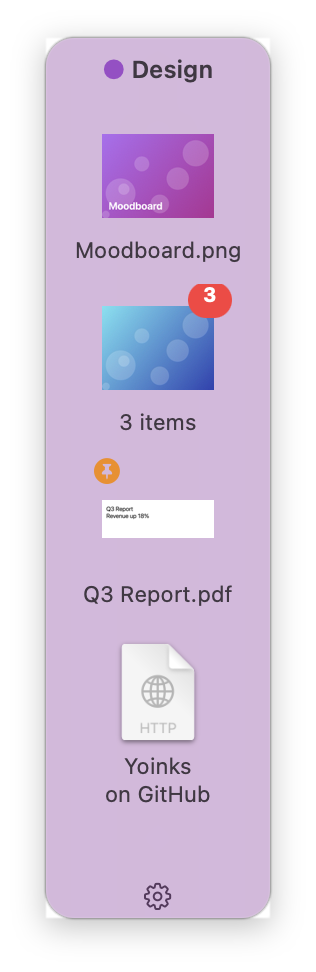
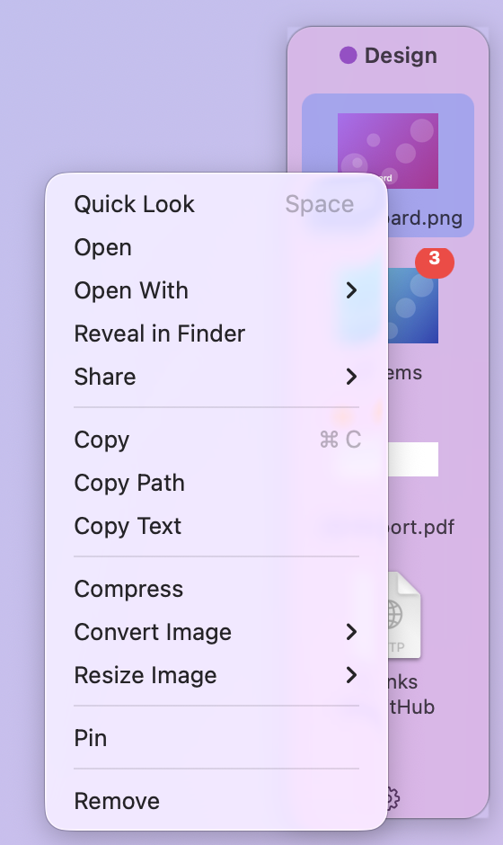
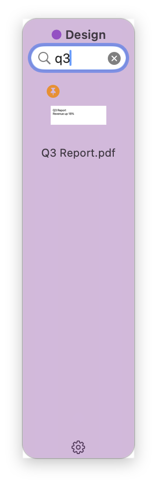
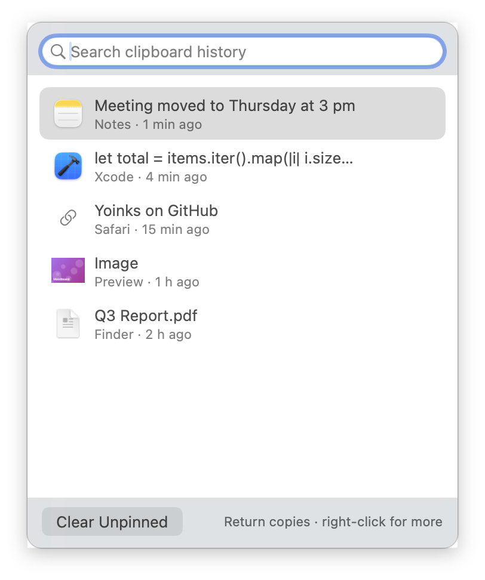
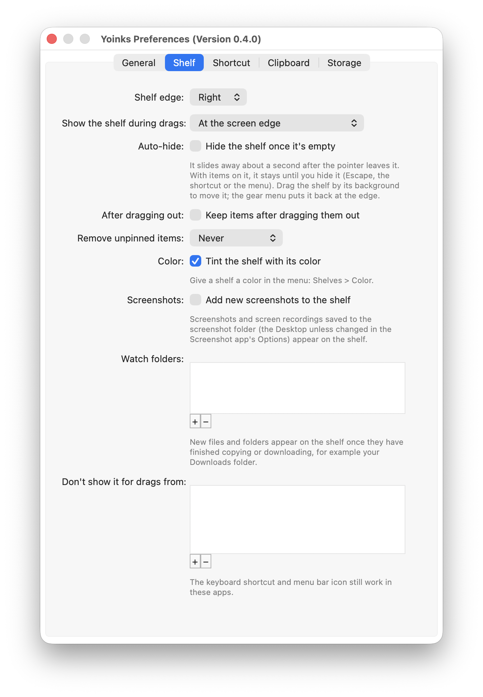
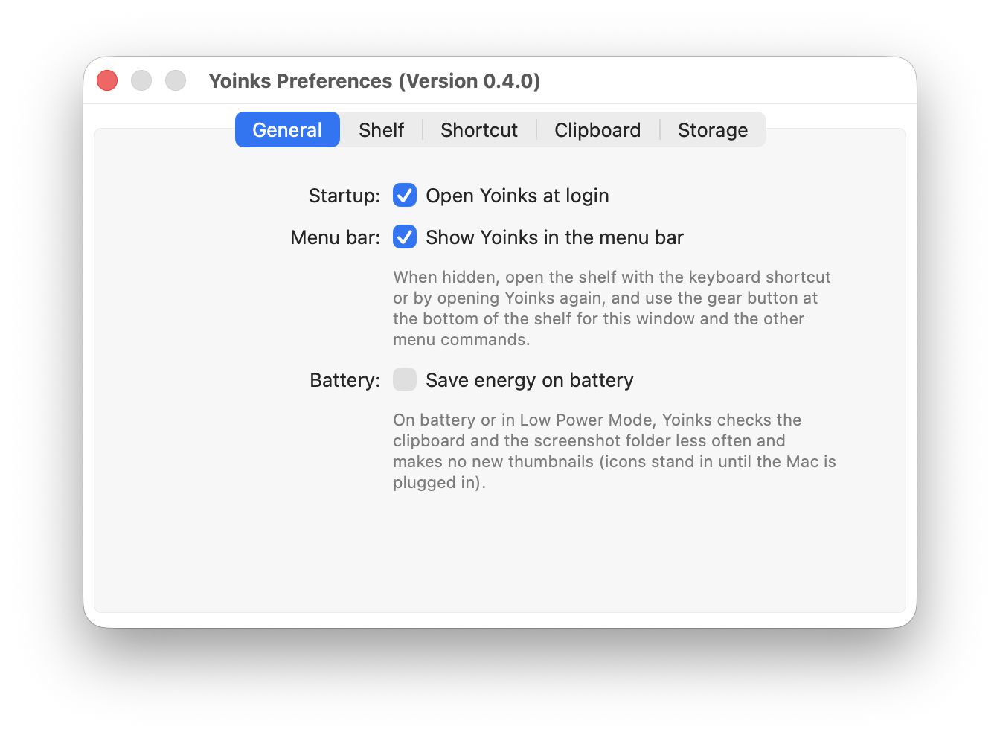
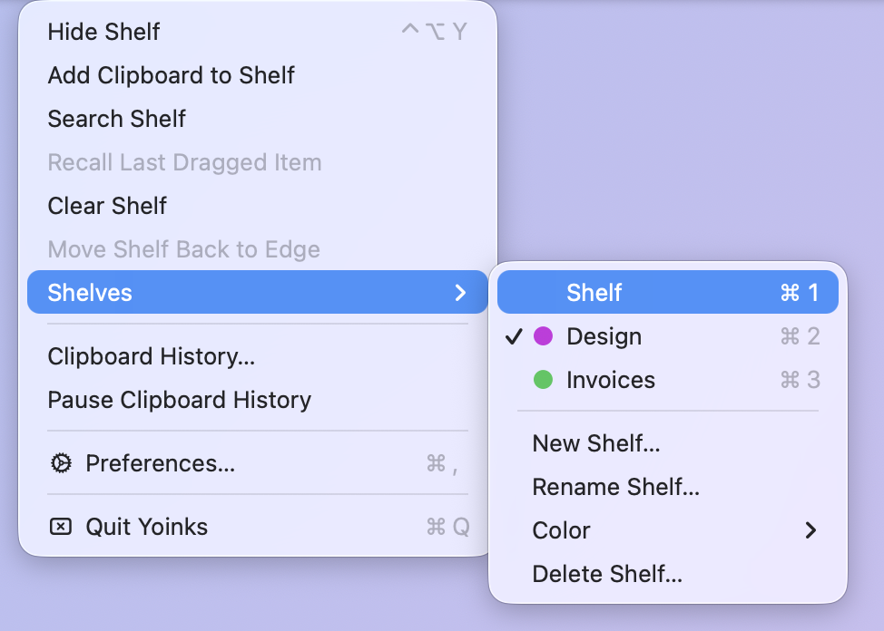

# Yoinks

A drag-and-drop shelf for macOS, written in Rust and inspired by
[Yoink](https://eternalstorms.at/yoink/mac/). Park files, text, links and
images on a shelf at the edge of the screen while you move between windows,
Spaces and full-screen apps, then drag them out where you need them.

Free and open source. Requires macOS 13 or later on Apple silicon.

<p align="center">
  
  &nbsp;&nbsp;
  
  &nbsp;&nbsp;
  
</p>

## Features

**The shelf**

- **Appears when you drag.** Start dragging anything and the shelf slides
  in at the screen edge (or next to the cursor, only when you approach the
  edge, or when you shake the pointer). It hides again if you don't use it;
  with items on it, it stays until you hide it.
- **Holds almost anything.** Files (as references, never copied), Mail and
  Photos attachments, text, rich text, links and images. Several items
  dropped together become a stack.
- **Drag out with Finder rules.** Same volume moves, another volume copies,
  Option copies, Command moves. Text and links drop into text fields as
  text.
- **Named shelves** with Finder-style color tags, to keep things apart (say,
  "Invoices" and "Design"). Switch from the menu or with ⌘1 to ⌘9; a shelf
  can be tinted with its color.
- **Search** by name, link, kind or the text inside text items: just start
  typing on the shelf, or press ⌘F.
- **Pinning.** Pinned items stay after you drag them out and survive Clear
  Shelf. Unpinned items can also expire after an hour to 30 days.
- **Arrange it.** Drag tiles up or down to reorder them. Drag the shelf by
  its background to move it; "Move Shelf Back to Edge" undoes it.

**Doing things with items**

- **Quick actions** on a tile's menu: Quick Look, Open With, Share (AirDrop,
  Mail, Messages, ...), Copy, Copy Path, Copy Text (recognizes the text in
  an image), Rename, Compress, and Convert or Resize images. Results land on
  the shelf as new items; originals are never changed.
- **Recall.** The last 10 items you dragged out can be brought back, even if
  Finder moved them.
- **Keyboard.** ⌃⌥Y shows or hides the shelf, hold it to recall the last
  item, press it twice to add the clipboard. On the shelf, arrows select,
  Space previews, Return opens, Delete removes, ⌘C copies and ⌘V pastes.

**Getting things onto the shelf**

- **From anywhere:** drop onto the menu bar icon, "Yoinks" in other apps'
  Share menus, "Add to Yoinks" in
  the Services menu and Finder's Quick Actions, Shortcuts actions, the
  `yoinks` command and `yoinks://` links.
- **Automatically,** if you like: new screenshots and screen recordings, and
  new files in folders you watch (say, Downloads, once a download finishes).

**Clipboard history**



- Everything you copy, searchable from the menu bar, with pins.
- Password managers and content marked as concealed are never recorded,
  and copies that look like passwords, API keys or tokens are skipped (this
  can be turned off).
- Copy a clip back, or put it on the shelf.

<br clear="right">

**And**

- **Automatic updates** through [Sparkle](https://sparkle-project.org).
- **Saves energy on battery** if you like: fewer checks and no new
  thumbnails while unplugged or in Low Power Mode.
- **Preferences** for all of it, applied instantly.

<p align="center">
  
  &nbsp;
  
</p>

## Install

With [Homebrew](https://brew.sh):

```sh
brew install --cask houseofmackee/tap/yoinks
```

This also links the `yoinks` command. Yoinks updates itself, so
`brew upgrade` leaves it alone (`brew upgrade --cask --greedy yoinks`
updates it through Homebrew instead), and `brew uninstall --zap --cask
yoinks` also removes its shelves, history and settings.

Or download `Yoinks-<version>.dmg` from
[Releases](https://github.com/houseofmackee/yoinks/releases), open it and
drag Yoinks into Applications. Releases are signed with a Developer ID and
notarized by Apple, so Yoinks opens like any other app. To build it
yourself, see [Building](#building).

Yoinks lives in the menu bar; it has no Dock icon. You can hide the menu bar
icon in Preferences: the same menu is always available from the gear button
at the bottom of the shelf, and opening Yoinks again brings up the shelf.

On the second launch Yoinks asks whether to check for updates automatically
(once a day); change that in Preferences > General, or choose Check for
Updates… from the menu at any time. Pre-releases are not offered as
updates.

## Using Yoinks

| To | Do |
| --- | --- |
| Put something on the shelf | Drag it to the shelf or onto the menu bar icon, share it to Yoinks, or press ⌃⌥Y twice to add the clipboard |
| Reorder the shelf | Drag a tile up or down |
| Take it off | Drag it out, or right-click > Remove |
| Show or hide the shelf | ⌃⌥Y, the menu bar icon, or Escape |
| Bring back what you dragged out | Hold ⌃⌥Y, or menu bar > Recall Last Dragged Item |
| Preview | Select a tile and press Space |
| Find something | Click the shelf and start typing, or press ⌘F; Escape ends the search |
| Keep an item after dragging it out | Right-click > Pin |
| Send it somewhere | Right-click > Share > AirDrop, Mail, Messages, ... |
| Copy, rename, zip or convert it | Right-click > Copy, Rename…, Compress, Convert Image |
| Get the text out of an image | Right-click > Copy Text |
| Paste onto the shelf | Click the shelf and press ⌘V |
| Split a stack | Right-click > Unstack |
| Keep things apart | Menu bar > Shelves > New Shelf…, Color; switch with ⌘1 to ⌘9 on the shelf |
| Move the shelf | Drag its background (between or below the tiles) |
| Clipboard history | Menu bar (or the shelf's gear) > Clipboard History… (type to search, Return copies) |
| Preferences | Menu bar or the shelf's gear button > Preferences… |

<p align="center">
  
</p>

### Share menu and Shortcuts

"Yoinks" appears in other apps' Share menus (Safari, Photos, Finder and
more): shared files, images, links and text go on the shelf. If it is
missing, switch it on in System Settings > General > Login Items &
Extensions > Sharing.

The Shortcuts app gets these actions: Add Files to Shelf, Add Text to Shelf,
Add Link to Shelf, Get Shelf Items, Show Shelf, Hide Shelf, Clear Shelf,
Bring Back Last Item and Switch Shelf. Show, recall and clear are also
offered as App Shortcuts in Spotlight and Siri ("Show the Yoinks shelf").

### Command line

The app binary doubles as a command line tool (Homebrew links it for you).
Otherwise, link it somewhere on your `PATH`:

```sh
ln -s /Applications/Yoinks.app/Contents/MacOS/yoinks ~/.local/bin/yoinks
```

```sh
yoinks add report.pdf notes.txt     # one stack
yoinks add --text "Call Sam at 3"
yoinks add --url https://example.com --title "Example"
yoinks list                          # or: yoinks list --json
yoinks show | hide | recall | clear
yoinks shelf                         # list shelves; yoinks shelf Invoices switches
```

Yoinks is started in the background if it is not running.

### Links

`yoinks://add?path=/absolute/path` (repeat `path` for a stack),
`yoinks://add?text=...`, `yoinks://add?url=...&title=...`,
`yoinks://show`, `yoinks://hide`, `yoinks://recall`. Values are
percent-encoded. Links can't clear the shelf.

## Settings and data

Everything is in `~/Library/Application Support/Yoinks`:

| Path | Contents |
| --- | --- |
| `settings.json` | Preferences (editable by hand; restart Yoinks after editing) |
| `shelves.json` | The named shelves, their colors and which one is showing |
| `shelf.json`, `Shelves/` | The first shelf, and one file per other shelf |
| `Items/` | Copies of dropped text, images and attachments |
| `clipboard.json`, `Clips/` | Clipboard history |
| `Thumbnails/` | Cached previews |

Set `YOINKS_DATA_DIR` to use a different folder (handy for testing).

No account, analytics or crash reporting. The only network access is the
update check, if you allow it: it fetches `appcast.xml` from GitHub
Releases and sends nothing about your Mac (Sparkle's system profiling is
off).

## Building

Needs Rust (stable) and Xcode (for the Swift parts: the Share extension and
the Shortcuts actions).

```sh
cargo test                     # unit tests
scripts/bundle.sh              # target/debug/Yoinks.app
scripts/bundle.sh release      # target/release/Yoinks.app
scripts/make-dmg.sh            # target/release/Yoinks-<version>.dmg
scripts/dist.sh                # target/dist: DMG, zip and SHA256SUMS.txt
swift scripts/make-icon.swift  # regenerate macos/AppIcon.icns
```

`bundle.sh` registers the app with Launch Services so the link scheme and the
service work during development (set `YOINKS_SKIP_REGISTER=1` to skip). Debug
builds are signed ad hoc; release builds use a Developer ID Application
identity if one is in the keychain (`YOINKS_TEAM_ID` picks the team), then
the self-signed "Yoinks Release" certificate, otherwise ad hoc
(`SIGN_IDENTITY` overrides). With a Developer ID, `dist.sh` also notarizes
and staples the app and the DMG when `YOINKS_NOTARY_KEY` (the `.p8` path),
`YOINKS_NOTARY_KEY_ID` and `YOINKS_NOTARY_ISSUER` are set.

The Swift parts are built without an Xcode project. `build.rs` compiles
`swift/Intents.swift` (the Shortcuts actions) into a static library linked
into the app, and `bundle.sh` generates their `Metadata.appintents` with
Xcode's metadata processor and builds `swift/ShareExtension.swift` into a
sandboxed `Contents/PlugIns/YoinksShare.appex`. `YOINKS_NO_INTENTS` and
`YOINKS_NO_SHARE` leave them out.

Release bundles embed Sparkle 2, downloaded once by `scripts/sparkle.sh` at
a pinned version and checksum (`YOINKS_NO_SPARKLE=1` leaves it out). With
`YOINKS_SPARKLE_KEY` (the path to the EdDSA private key) `dist.sh` also
writes a signed `appcast.xml`, which the app reads from the latest
release. `CFBundleVersion` is the version without the hyphen and dot
(`0.2.0beta2` for `0.2.0-beta.2`, see `scripts/version.sh`), because
Sparkle compares that and would otherwise treat all of 0.2.0's
pre-releases and 0.2.0 itself as the same version. Back the key up outside
GitHub: without it, installed copies can't verify new updates. To try an
update locally, run a release build with `YOINKS_UPDATE_TEST=1` and
`YOINKS_FEED_URL` pointing at a test feed signed with the same key.

GitHub Actions runs `cargo fmt --check`, `cargo clippy -D warnings` (debug and
release), `cargo test`, a release bundle build and `cargo deny check` (see
`deny.toml`) on every push to master and every pull request.

The screenshots in `docs/screenshots` show demo data, not anyone's real
shelf.

### Releasing

Releases are built and published by GitHub Actions, not from a local machine.
Move the `[Unreleased]` entries in `CHANGELOG.md` under a new
`## [x.y.z] (date)` heading, bump the version in `Cargo.toml`, commit, then
push a matching tag:

```sh
git tag v0.5.0 && git push origin master v0.5.0
```

`.github/workflows/release.yml` checks the tag matches `Cargo.toml`, signs
with the Developer ID Application certificate from the repository secrets
`DEVELOPER_ID_P12_BASE64` and `DEVELOPER_ID_P12_PASSWORD`, notarizes with
the App Store Connect API key in `NOTARY_API_KEY_BASE64` (and the
`APPLE_TEAM_ID`, `NOTARY_KEY_ID` and `NOTARY_ISSUER_ID` variables), signs
the update feed with `SPARKLE_PRIVATE_KEY`, uses the version's
`CHANGELOG.md` section (`scripts/release-notes.py`) as the notes in the
update window and on the GitHub release, runs `scripts/dist.sh` and
publishes the DMG, zip, `SHA256SUMS.txt` and `appcast.xml`. For full
releases it also updates the cask in
[houseofmackee/homebrew-tap](https://github.com/houseofmackee/homebrew-tap)
with the `TAP_DEPLOY_KEY` deploy key. Keep backups of the `.p12`, `.p8` and
Sparkle key outside GitHub. Tags with a hyphen (`v0.5.0-beta.1`) become
pre-releases; installed copies only update to full releases, because the
feed is read from the latest one. Do not create releases by hand with
`gh release create`.

## Status

See [PLAN.md](PLAN.md) for the roadmap and [CHANGELOG.md](CHANGELOG.md) for
what changed in each version. Still to do: a widget, editing text clippings
on the shelf, and integration tests for the command line.

Release builds include [Sparkle](https://sparkle-project.org) for updates,
under its own MIT-style license; the notice ships in the app as
`Contents/Resources/Sparkle-LICENSE.txt`.
